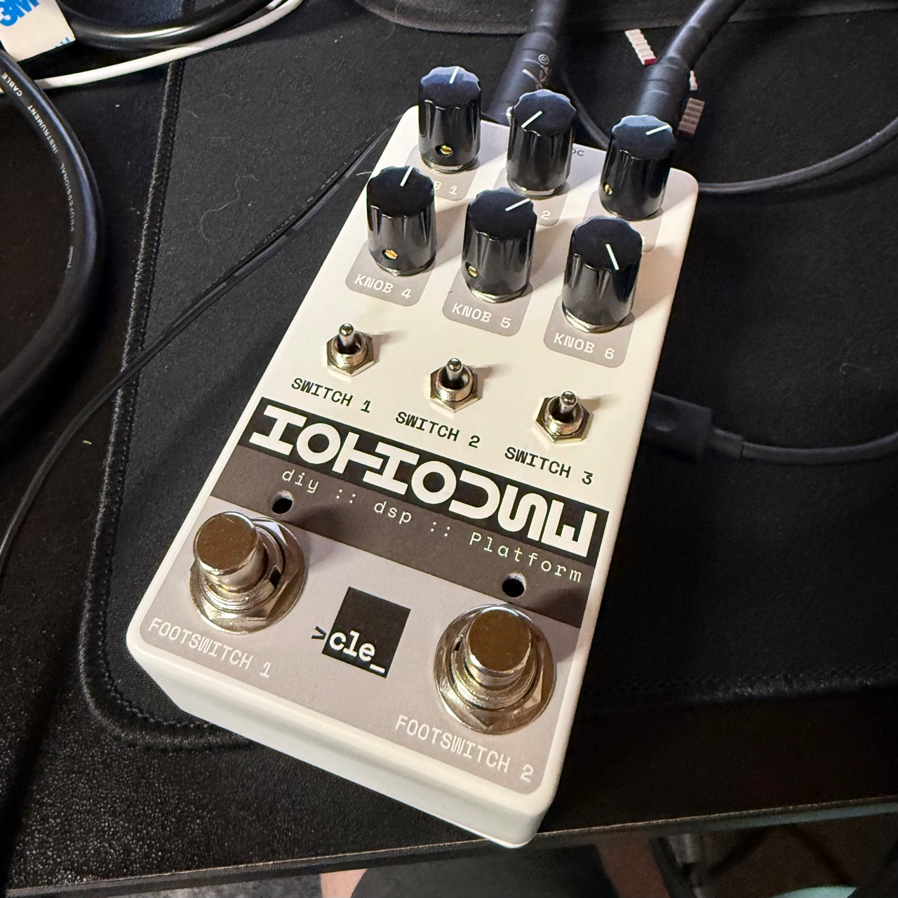

# Hothouse NAM Player

Open-source A2-Lite NAM firmware for the Cleveland Music Co. Hothouse / Daisy
Seed. The firmware runs at 48 kHz with 48-sample blocks and supports three
user-installable capture slots.



## Signal path

`mono input -> input gain -> optional A2-Lite model -> optional cabinet IR -> 3-band EQ -> reverb -> output level -> stereo output`

The default evaluator is the TONE3000 Cortex-M7 A2-Lite engine, validated
on the connected Hothouse with installed captures. A smooth input noise gate
prevents the Hothouse input-stage noise floor from exciting the model while
preserving quiet note decay. See the measured effects-chain limits below.

`firmware/hothouse_nam_host.cpp` owns product behavior and uses the small
`firmware/nam_engine.h` interface. `firmware/nam_engine.cpp` loads the
1,871 selected floating-point weights into the TONE3000 runtime and
processes 48-sample blocks. Engine code runs in ITCM, weights and hot state
in DTCM, and delay histories in cached AXI SRAM. The host tool and web editor
search every model in a Tone3000 slimmable download, select a compatible A2-Lite
submodel, and transfer the same tagged weight payload used by all three slots.

## Controls

- Knob 1: input gain, logarithmic 0.25x–4x with unity at noon
- Knob 2: reverb wet/dry mix
- Knob 3: output level
- Knob 4: bass, ±10 dB
- Knob 5: middle, ±10 dB
- Knob 6: treble, ±10 dB
- Toggle 1: selected UP reverb / off / selected DOWN reverb
- Toggle 2: cabinet IR A / off / B
- Toggle 3: capture slot A / B / C
- Footswitch 1: processed/dry bypass
- Footswitch 2 short press: engage the saved preset or return to the panel
- Footswitch 2 hold: save the panel settings and engage the preset
- Hold both footswitches: persistent Daisy DFU recovery

LED 1 shows the effect state. LED 2 shows the preset state and fast-blinks for
a model fault or deadline overrun. Presets survive power loss. Toggle 3 always
follows its physical position because changing it may reload a model.

## Set up and build

Requirements:

- Git, Python 3, and GNU Make
- The [Arm GNU Toolchain](https://developer.arm.com/downloads/-/arm-gnu-toolchain-downloads)
  for the `arm-none-eabi` target, including its Newlib headers and libraries
- [`dfu-util`](https://dfu-util.sourceforge.net/) for flashing (`brew install
  dfu-util` on macOS)

```sh
git clone --recursive https://github.com/breakall/hothouse-nam-player.git
cd hothouse-nam-player
make setup-tone3000
make firmware USE_IR=0
```

The build automatically discovers Arm's macOS installer under
`/Applications/ArmGNUToolchain`. On another platform or with a custom
installation, set `GCC_PATH` to the toolchain's `bin` directory.

The firmware is written to `firmware/build/firmware/hothouse_nam.bin`.

To build with one or two mono, 48 kHz cabinet IRs capped at 1,024 taps:

```sh
make firmware USE_IR=1 \
  IR_A="/absolute/path/to/cab-a.wav" \
  IR_B="/absolute/path/to/cab-b.wav"
```

`IR_A` is required when `USE_IR=1`; `IR_B` is optional. With only IR A,
both outer Toggle 2 positions select it. The middle position bypasses the
cabinet stage for full-rig captures.

## Install captures over USB

The browser-based [Hothouse NAM Editor](https://github.com/breakall/hothouse-nam-pedal-editor)
is a graphical alternative to the command-line tools below. In desktop Chrome
or Edge, it connects directly to the pedal over Web Serial to install, replace,
or delete captures and configure the UP and DOWN reverb assignments.

For command-line use, the pedal stores up to three captures through its normal
USB connection:

```sh
python3 tools/install_capture.py "/absolute/path/to/capture-a.nam" --slot A
python3 tools/install_capture.py "/absolute/path/to/capture-b.nam" --slot B
python3 tools/install_capture.py --list
python3 tools/install_capture.py --delete-slot C
```

The installer requires an A2 `.nam` file containing a compatible 48 kHz,
3-channel A2-Lite model with 1,871 weights. For a `SlimmableContainer`, it
examines every submodel and selects the first compatible one. Full A2 models
are rejected because they cannot meet the Daisy Seed real-time budget.

Transfers use acknowledged 128-byte chunks and CRC-32 verification. Captures
survive power cycles. Selecting an empty slot bypasses only the model stage.
Selecting a new slot cuts audio immediately, waits 60 ms for the switch to
settle, loads only the final slot, and fades audio in over 20 ms.

Capture slots occupy QSPI offsets `0x007b0000`–`0x007eefff`. Reverb
configuration at `0x007f0000` and presets at `0x007ff000` are separate.

## Reverb configuration

The firmware includes `reverbsc`, `dattorro`, `fdn16`, and `hybrid`.
Only the two engines assigned to Toggle 1 are instantiated. Configure them:

```sh
python3 tools/configure_reverbs.py list
python3 tools/configure_reverbs.py info
python3 tools/configure_reverbs.py map up hybrid
python3 tools/configure_reverbs.py map down dattorro
```

## Flash

Build first, start the watcher with direct USB access, and then hold both
footswitches for two seconds:

```sh
./tools/wait_and_flash_hothouse.sh firmware/build/firmware/hothouse_nam.bin
```

Three alternating LED flashes confirm the recovery gesture. A successful
upload reports both `Download done` and `File downloaded successfully`.

## Tests

```sh
make test
```

The suite covers capture parsing and flash persistence, mute/settle/load/fade
transitions, reverb engines, A2 model selection and validation, and installer
transfer cancellation. `make test-engines` additionally compares both engines
with NAMCore reference output after both runtime dependencies are installed.

## Performance and diagnostics

TONE3000 is the default A2-Lite engine. On the connected Hothouse, it used
40.39% fewer engine cycles than the original runtime: 39.83% versus 66.82%
of the 1 ms block budget with the same installed Hiwatt capture. Both kernels
passed the same 96,000-sample NAMCore reference test.

The maximum 1,024-tap IR plus reverb exceeds the current full-chain budget.
With FDN16, warmed processing averaged 124.63% and peaked at 127.05%; a
prewarmed live callback also tripped the deadline guard. IR length support is
not a guarantee that every effects combination can run in real time.

The [benchmark report](benchmarks/README.md) contains raw measurements, build
identities, limits, and reproduction commands. Its full-chain diagnostic is
compiled only with `STRESS_TEST=1` and `USE_IR=1`; normal firmware excludes it.
`HNAM ENGINE` identifies the implementation while the capture/editor protocol
continues to report `a2_lite`. Existing captures need no conversion.

For optional fallback or numerical comparison with the previous runtime:

```sh
make setup-a2
make test-engines
make firmware NAM_ENGINE=legacy USE_IR=0
```

Legacy firmware is written to `firmware/build/firmware-legacy/hothouse_nam.bin`.

## Licensing

Project firmware is GPL-3.0, matching HothouseExamples. libDaisy and DaisySP
retain their licenses. The A2 evaluator uses a pinned MIT-licensed runtime
from TONE3000, with the original DaisySeedProjects runtime retained as an
optional fallback; see [THIRD_PARTY_NOTICES.md](THIRD_PARTY_NOTICES.md).
Captures and cabinet IRs are not included; users must supply licensed assets.
