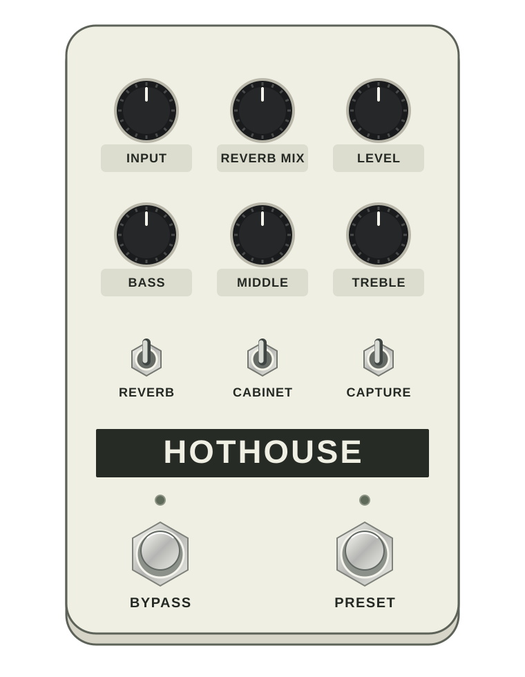

# Hothouse NAM Player

Turn your Hothouse into a standalone amp-capture pedal. Load three guitar
sounds, shape them with bass, middle and treble, add stereo reverb, and save
your go-to settings for footswitch recall.

Open-source firmware for the Cleveland Music Co. Hothouse with a Daisy Seed.
Once set up, it plays without a computer connected.



## What it brings to your board

- **Three sounds on tap.** Keep a clean, an edge-of-breakup and a driven capture
  loaded, then choose between them with a toggle.
- **Drive and volume as separate controls.** Adjust the level hitting the amp
  model, then set the output to suit the rest of your rig.
- **Hands-on tone shaping.** Dedicated bass, middle and treble knobs let you
  adjust a capture without reaching for a computer.
- **Stereo reverb.** Choose two of the four included reverb sounds for the
  toggle's up and down positions, with a dedicated wet/dry knob.
- **A saved setting under your foot.** Store one panel preset and switch
  between it and your live knob settings.
- **USB capture loading.** Replace sounds without rebuilding or reflashing the
  firmware. Your captures and saved settings stay on the pedal after power-off.

## Bring your own amp sounds

A NAM capture models the sound and response of captured gear. This pedal
plays **compatible A2-Lite `.nam` captures**, including compatible models
inside TONE3000 slimmable downloads. It doesn't support every NAM file;
full-size A2 models and other NAM architectures aren't supported.

You can use a full-rig capture that already includes the cabinet, or an
amp-only capture with a separate cabinet impulse response (IR). Cabinet IRs
are optional and included when you build the firmware; they aren't uploaded
alongside captures over USB. The standard build leaves the cabinet IR stage
off.

Captures and cabinet IRs aren't bundled with this project.

## Load it, dial it in, play

With the firmware installed, open the
[Hothouse NAM Editor](https://github.com/breakall/hothouse-nam-pedal-editor)
in desktop Chrome or Edge and connect the pedal over USB. The editor lets
you install, replace and delete captures, and choose which reverbs sit on the
up and down sides of the reverb toggle.

1. Load compatible captures into slots **A, B and C**.
2. Choose a slot with **Toggle 3**.
3. Set input gain, EQ, reverb and output level to taste.
4. Hold **Footswitch 2** to save the panel settings. Tap it to switch between
   that preset and the live panel.
5. With the pedal powered from your normal supply, disconnect USB to play
   standalone.

One capture runs at a time. Changing captures briefly mutes the sound and
fades the new capture in. The capture toggle always follows its physical
position, including while a preset is engaged.

## Find your way around the pedal

Knob and toggle numbers refer to the printed labels on the enclosure.

| Knob | What it does |
| --- | --- |
| 1 — Input gain | Push the model harder or back it off; noon is unity |
| 2 — Reverb mix | Blend between dry signal and reverb |
| 3 — Output level | Set the final volume |
| 4 — Bass | Cut or boost lows; noon is neutral |
| 5 — Middle | Cut or boost mids; noon is neutral |
| 6 — Treble | Cut or boost highs; noon is neutral |

| Toggle | Up / middle / down |
| --- | --- |
| 1 — Reverb | Assigned reverb / off / assigned reverb |
| 2 — Cabinet | IR A / off / IR B, when built with cabinet IRs |
| 3 — Capture | Slot A / slot B / slot C |

**Footswitch 1** switches between the processed sound and dry bypass.
**Footswitch 2** recalls the saved preset or returns to the panel; hold it to
save the current panel settings. There is one saved panel preset, separate
from the three capture slots.

LED 1 shows whether processing is on. LED 2 shows whether the preset is
engaged; a fast blink signals a model or processing fault.

## A few useful limits

The amp path is mono, with stereo reverb at the output. Selecting an empty
capture slot skips the amp model, so you can still use EQ and reverb.

Cabinet IRs and reverb share the pedal's processing capacity. The longest
supported IR combined with reverb was too demanding in our stress test.
Some combinations need more processing power than the pedal has. The
[testing notes](benchmarks/README.md) document the measured limits.

## Build and install

You'll need an assembled Hothouse with a Daisy Seed, a USB data connection,
and a computer with Git, Python 3, GNU Make, the
[Arm GNU Toolchain](https://developer.arm.com/downloads/-/arm-gnu-toolchain-downloads)
and [dfu-util](https://dfu-util.sourceforge.net/).

<details>
<summary>Build the firmware and put it on the pedal</summary>

```sh
git clone --recursive https://github.com/breakall/hothouse-nam-player.git
cd hothouse-nam-player
make setup-tone3000
make firmware USE_IR=0
```

The build finds Arm's standard macOS toolchain installation automatically.
Elsewhere, set `GCC_PATH` to your toolchain's `bin` directory.

Build first, then start the USB flash watcher:

```sh
./tools/wait_and_flash_hothouse.sh firmware/build/firmware/hothouse_nam.bin
```

Once the watcher is running, hold both footswitches for at least two seconds.
Three alternating LED flashes confirm the gesture. A successful upload prints
`Download done` and `File downloaded successfully`. On systems with USB
access restrictions, give the watcher direct device access.

To include cabinet IRs, supply one or two mono, 48 kHz WAV files:

```sh
make firmware USE_IR=1 \
  IR_A="/absolute/path/to/cab-a.wav" \
  IR_B="/absolute/path/to/cab-b.wav"
```

IR B is optional; with only IR A, either outer cabinet-toggle position selects
it. The build caps each IR at 1,024 samples. Keep the processing limits above
in mind when combining cabinet IRs and reverb.

</details>

<details>
<summary>Load captures from the command line</summary>

```sh
python3 tools/install_capture.py "/absolute/path/to/clean.nam" --slot A
python3 tools/install_capture.py "/absolute/path/to/crunch.nam" --slot B
python3 tools/install_capture.py "/absolute/path/to/drive.nam" --slot C
python3 tools/install_capture.py --list
```

The installer checks compatibility before transferring a capture. Use
`--delete-slot A` to clear a slot.

</details>

## Make it your own

The firmware is open to modification. Start with
[the main pedal code](firmware/hothouse_nam_host.cpp) for controls and signal
routing, or [the reverb rack](firmware/reverb_rack.h) for the reverb choices.
Run `make test` to check the host-side tests after making changes. The
[benchmark report](benchmarks/README.md) has deeper engine and timing details.

## License

Project firmware is GPL-3.0. The libraries and TONE3000 engine retain their
own licenses; see [third-party notices](THIRD_PARTY_NOTICES.md). Supply
captures and cabinet IRs that you have permission to use.
